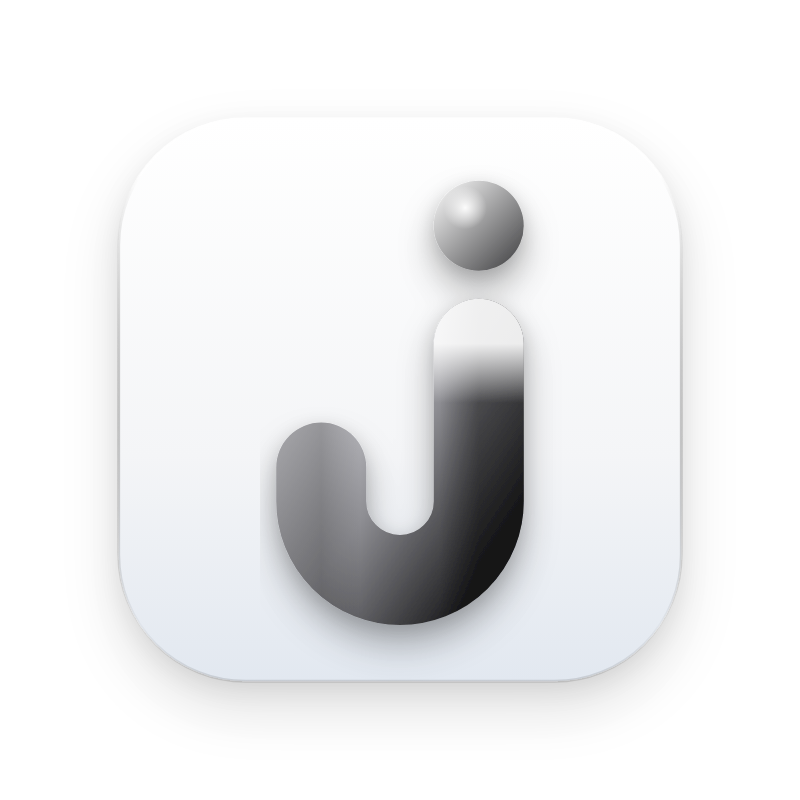
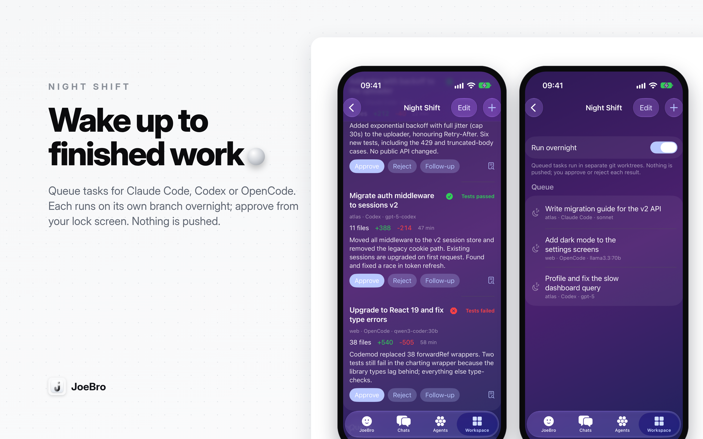
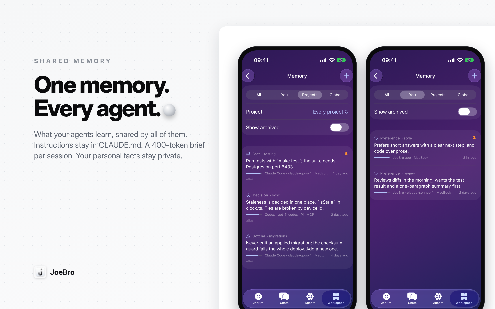
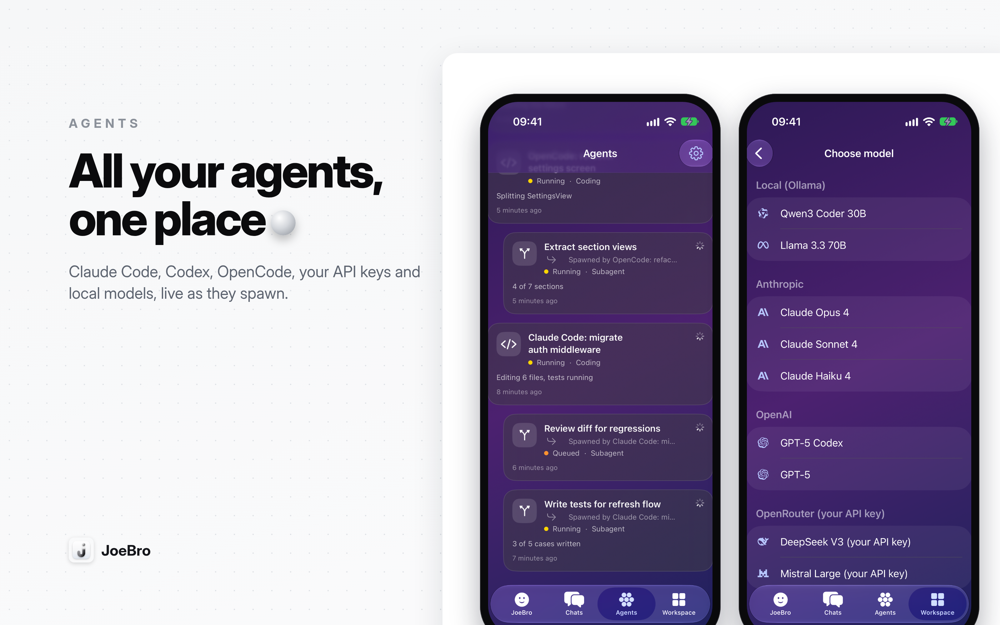
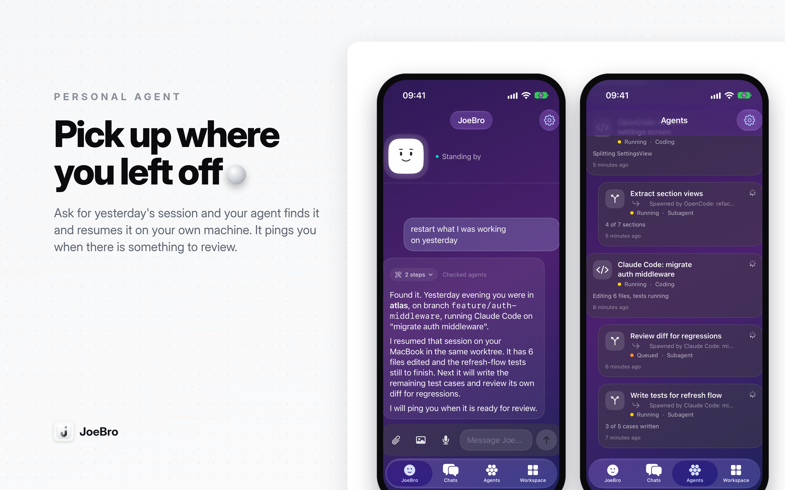
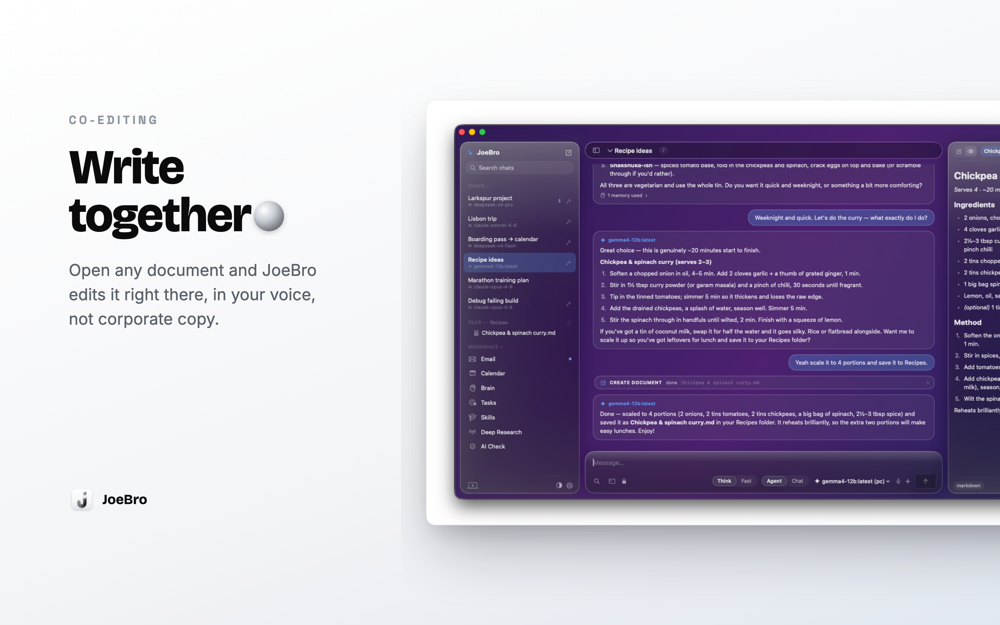
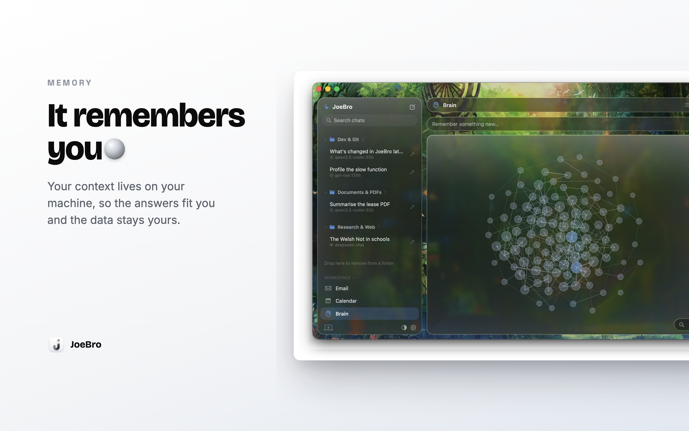
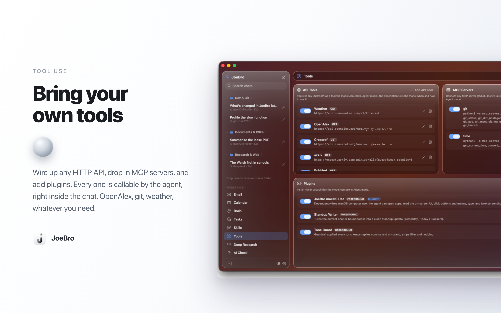

<p align="center">
  
</p>

<h1 align="center">JoeBro</h1>

<p align="center">
  The free way to bring all your existing agents under one umbrella.<br>
  Claude Code, Codex and OpenCode, plus your own API keys and local models.<br>
  On your Mac, your iPhone and your own hardware.
</p>

<p align="center"><a href="https://joebro.pages.dev/"><b>joebro.pages.dev</b></a></p>

**Sister repo:** the iPhone app is **[JoeBro Mobile](https://github.com/joexk1/JoeBro-Mobile)**. It talks to this app on your Mac, with no cloud in between.

---

## One umbrella for your agents

You probably already use more than one AI agent. Claude Code for one job, Codex for another, OpenCode with a local model for a third. Each has its own memory file, its own sessions and its own place to check on it.

JoeBro puts them in one place. Link them once with [joebro-plugins](https://github.com/joexk1/joebro-plugins) and they show up together on your Mac, your iPhone and your own hardware, next to your chats on any model, whether that is a local one or your own API key. It is free, and nothing goes through a JoeBro server, because there isn't one.

New in 1.5:

- **Night Shift.** Queue coding tasks. They run overnight, each in its own git branch, on whichever machine has the repo. In the morning you get review cards with the diff, the test result and a summary. Approve or reject from the Mac or from your iPhone lock screen. It never pushes.
- **Shared Memory.** One project memory that every agent reads and writes over MCP, for what they learn: decisions, gotchas, what was tried.
- **Live agents and subagents.** They appear in the Agents panel as they start, and on the phone and in the Dynamic Island, even with the app in the background.
- **Resume.** Your personal agent can pick up a coding session. "Pick up what I was working on yesterday and add tests."
- **Morning briefing and proactive mode** are now in the shipped app.

---

## Night Shift

Add a task from the Mac or from your phone: a repo, a prompt and optionally a test command. Choose Claude Code, Codex or OpenCode. When the night window opens, JoeBro runs the next task in its own git branch and worktree, on whichever linked machine has the repo.

In the morning each task is a review card: the diff, whether the tests passed, and a summary. **Approve** keeps the branch (or merges it locally, into a clean checkout of the base branch). **Reject** deletes the branch. You can also ask for a follow-up. On the iPhone you can do all of this from the lock screen.

Night Shift never pushes. Agents run with pushing switched off, and you decide what happens to the branch. Set a time window, a time limit per task and a budget where the agent supports one.



---

## Shared Memory

Agents learn things as they work: a decision, a gotcha, what was tried and didn't work. Usually that's lost when the session ends, or it gets pasted into CLAUDE.md until the file is mostly old notes. And Codex never sees what Claude Code learned.

Shared Memory is one store per project. Claude Code, Codex and OpenCode read and write it over MCP. Each session starts with a short brief, capped at about 400 tokens, and agents can search for more when they need it. It holds what agents learn as they work (decisions, gotchas, what was tried), so that stops piling up in CLAUDE.md. Instructions such as build commands and conventions stay in CLAUDE.md and AGENTS.md. `joebro-agents memory import --write` moves Claude Code's learned memory across, backs it up, and adds a short pointer to CLAUDE.md and AGENTS.md without touching what's already there. Add `--include-instructions` to also copy facts out of those files; they still aren't changed.

- **Strengthens with use, fades without it.** Facts that get used grow stronger. Facts that don't, fade. Nothing is deleted. Old and replaced facts stay in history and can be restored.
- **Provenance.** Every fact shows which agent wrote it, with what model, on which machine.
- **Your personal facts stay yours.** They never reach a repo or a coding agent.
- **One Memory screen.** JoeBro's own memory (the Brain) is now part of this. You see you, your projects and global facts in one place, with search, pin, edit and archive.



---

## Agents and subagents, live

Linked agents appear in the Agents panel while they work. When an agent spawns a subagent, it shows up nested under its parent, with a count on the parent row. The iPhone and the Dynamic Island show the same thing. New runs appear on the Island even when the app is in the background, using push-to-start (you bring your own Apple push key, as before).

Subagent reporting is verified with Claude Code. Codex and OpenCode are supported on a best-effort basis.



---

## Resume a coding session

JoeBro records your recent coding sessions. Ask your personal agent to pick one up: "pick up what I was working on yesterday and add tests". Or press Resume on a session in the Night Shift panel. It starts the agent again in the repo, in tmux, on the machine that has it.



---

## Why JoeBro exists

Most people never get the most out of AI. Not because they couldn't, but because:

1. **The good stuff is hidden behind a learning curve.** Agents, tools, local models, document editing, automations. Most people only ever see a chat box.
2. **Nobody has time to learn it.** Reading docs, wiring up APIs and writing prompts is a job in itself, and you already have one.
3. **Big tech overcharges for it and watches you while you use it.** Your work, your inbox, your calendar and your half-formed ideas all become training data and ad signal.

JoeBro is another way. It hands a busy person the full power of modern AI without asking them to become a software engineer, and it does it while keeping their data on their own machine. You bring your own models (run them locally or plug in any API key), and JoeBro turns them into a real assistant that knows your work, edits your documents, reads your email, manages your calendar, runs research, and remembers what matters. No platform tax, and nobody looking over your shoulder.

AI is better when it knows you, so keep it close, away from big tech.

**Read the technical breakdown** on why I built this with zero dependencies and no Electron [on Dev.to](https://dev.to/joexk1/why-i-built-a-native-macos-ai-workspace-with-zero-dependencies-1c2i)

---

## What it is

JoeBro is a native macOS app (SwiftUI) with a small backend bundled right inside it. The backend is plain Python standard library, spawned automatically when the app launches and talking to it locally over `http://127.0.0.1:8765`. There is nothing to install, no account to make, and nothing leaves your Mac unless you explicitly connect an external model or mailbox.

It's one window, not ten apps:

**Core**
- **Chat** with any model, with live streaming, extended thinking, and a real agent mode. Sort chats into folders to keep side projects away from work, or split things by topic. Just drag and drop.
- **Agent mode** that uses tools. It reads files, edits documents, runs the terminal, searches the web, calls your own APIs, and manages your calendar and email.
- **Deep Research** that reads many sources and writes a cited report.
- **Documents** opened right beside the conversation, including real Word `.doc` and `.docx` files, edited in place.
- **Flashcards**: ask for a study deck and it lands in your folder as a real Anki `.apkg`. Flick through it card by card in the workspace — learned or still learning — or import it straight into Anki.



- **Theming**: an adaptive glass interface over any wallpaper you choose, with built-in colour accents to match your style.


**Workspace tools**, all local, self-improving, and manually manageable.
- **Inbox and phone memory**: notices from your phone agent, and the memory files it reads. See the 1.3 section below.
- **Email** over IMAP: read, compose, reply, forward, triage. All on your machine.
- **Calendar**: your events, add, edit and delete, all from within the app.
- **Brain**: long-term memory that persists across sessions and improves the more you use it. Every memory is one self-contained fact — a lasting world fact, an experience, or an opinion you've expressed — filed on a topic page. Repeats merge into the page instead of piling up, and only what's relevant to the message at hand (plus anything you pin) ever reaches the model. Add, edit, search, or delete memories manually anytime. Opens as an interactive **brain map** — a live graph where lines join memories that share topics (shorter and heavier = more closely related), and the biggest nodes are the hubs the rest of your memories link back to. Drag nodes around, zoom in as deep as you like, or flip to a plain list.



- **Skills**: JoeBro teaches itself the things you do often. Review, edit, or prune them by hand whenever you like. Or point **Learn from sources** at a folder of past papers, analyses or templates and it studies them into a skill it can apply from scratch.
- **AI Check**: paste text to see how AI-written it reads, with the suspect sentences flagged.

For a full walkthrough of every tab, control and right-click menu, see the **[User Guide](USER_GUIDE.md)**. To go from zero to your first message in under a minute, start with **[Getting Started](GETTING_STARTED.md)**.

---

## New in 1.3: JoeBro on your iPhone

Pair a phone with your Mac and it becomes a second window into the same JoeBro. The phone app lives in its own repo, **[JoeBro Mobile](https://github.com/joexk1/JoeBro-Mobile)**. You build it yourself, so your bundle ID and your keys stay yours.

- **Phone pairing.** **Settings > Mobile**, turn on **Let my phone connect**, scan the QR code. Over Tailscale or your Wi-Fi, with a token. Off until you turn it on.
- **The phone agent.** One chat that follows your default model and hands hands-on work to chats you've bound to folders. It starts in Bound folder mode.
- **Phone memory.** Plain Markdown files you can read and edit, under **Brain > Phone memory**. `about-me` is always in context. The rest are pulled in when they're relevant.
- **Phone agent tasks.** **Tasks > Phone agent**. They run silently and only post the notification text.
- **Heartbeat.** Checks your calendar, reminders and task results every 30 minutes, and only calls a model when something changed. Quiet hours and daily limits, off by default.
- **Inbox.** A new tab for everything the agent, your tasks and your agents want to tell you.
- **Push.** Optional. Bring your own Apple key and upload it in **Settings > Mobile**. Without it the phone still works.
- **Cheap in the background.** Background work uses a small model, and nothing runs when nothing has changed.

No MCP server is ever added for you. The phone can't add one either. The phone only works while JoeBro is open and your Mac is awake. Weather and location are opt-in, and the only hosts they touch are open-meteo.com and nominatim.openstreetmap.org. Details in the **[User Guide](USER_GUIDE.md)**.

---

## Tools: bring your own

The Tools tab has three tiers, all surfaced to the model in Agent mode as callable functions. This is where JoeBro stops being a chat box and starts being a workspace the agent can actually act in.



- **API Tools** give any JSON endpoint straight to the model. Give it a URL, a name, a description, and optionally an API key and a method. Put `{query}` anywhere in the URL and the model's input gets dropped in right there. The description tells the model when to call it: a weather API when someone asks about the weather, a HackerNews search when the topic is tech. Point it at any public database right in chat (LinkedIn, Crunchbase, GitHub, you name it). No curated list, anything with a URL works.
- **MCP Servers** are the Model Context Protocol over stdio. The app launches the server, discovers its tools, and offers them to the model. The connection is stateless: spawn, initialize, call, kill. No long-running processes, no zombie children, and a hard wall-clock timeout on every interaction so a broken server never hangs a turn. The git MCP server returns real diffs: the model calls it, the server spawns, it runs, it dies, the diff comes back.
- **Plugins** are folders on disk that ship their own tools, memory, and agent logic. They can be foreground (active tools the model can invoke) or background (guardrails that shape every turn). The bundled one is the macOS Use plugin: dependency free, it drives the Mac through `osascript` and `screencapture`, calling System Events directly to open apps, click buttons, and take screenshots.

The agent calls API tools, MCP servers, memory, tasks, calendar, and plugins in one conversation. It looks like any other chat.

---

## Message Bot (Telegram)

Run JoeBro from your phone. Connect a Telegram bot and message it from anywhere to drive your whole workspace. It is an orchestrator, not a coder: it manages your chats and agents and delegates the hands-on work to them, then reports back.

**What it can do:**
- **Search and read** across all your chats, and summarise what they concluded.
- **Create** new chats, **bind** them to folders, and set their **mode** (chat/agent), **file-access level**, and **model**.
- **Delegate**: post a message into any chat and report back its agent's reply. This is how it gets work done, including reading and editing the files bound to that chat.
- Use your **email, calendar, memory, web search and deep research** directly.
- Never edits files or runs code itself. It hands coding and file tasks to a chat.

**Setup and use:**
- Configure in **Settings > Message Bot**: paste a bot token from Telegram's @BotFather, pick the model, and add your numeric Telegram ID to the allow list (message the bot once and it tells you your ID).
- Choose what each reply shows (skills, memories, tool calls, plugins), and whether it asks you to approve actions with a **y/n** reply.
- Commands: **/chats** lists your chats, **/compact** trims the conversation, **/help** shows what it can do.
- Replies **stream in live** and render **Markdown**. The bot conversation never appears in your sidebar.

Because the backend is bundled in the app, the bot is reachable whenever JoeBro is running on your Mac. Full walkthrough in the **[User Guide](USER_GUIDE.md)**.

---

## Local-first and private by design

- **Your data stays on your Mac.** Chats, memory, notes, tasks and documents live in a local SQLite store in `~/Library/Application Support/JoeBro/`.
- **Bring your own models.** Run local models with Ollama (or anything OpenAI-compatible) over your network, or paste an API key for DeepSeek, OpenAI, Anthropic, Groq, Gemini, OpenRouter and friends. You choose per message, and you can switch model mid-conversation without losing the thread.
- **Phone access is off until you turn it on.** When it's on, it's a separate listener that needs a token on every request, and it can't add MCP servers or plugins.
- **No telemetry, no middleman.** The app talks to its own local backend and to whichever model endpoints you set up. Nothing else is in the loop.
- **You hold the keys.** API keys are stored locally. When the agent touches files or runs commands, you decide how much access it gets.
- **Cloak Mode.** On by default: API keys, passwords, emails, card, passport and account numbers are swapped for placeholders like `[API KEY]` before any request leaves the backend — every model endpoint, local ones included. The model sees the shape of your data, never the values. One switch in Settings.

---

## Requirements

- **macOS 26 (Tahoe)** or later on Apple Silicon.
- **Xcode 26** or later to build it.
- **Python 3** (the system `python3` that ships with macOS is fine). The backend uses only the standard library, so there is nothing to `pip install`.

---

## Install (download)

Grab the latest **JoeBro.dmg** from the [Releases page](https://github.com/joexk1/joebro/releases), open it, and drag **JoeBro** into Applications.

**First launch, do this once.** JoeBro is a free indie app and isn't notarized by Apple, so macOS Gatekeeper blocks the *first* open. To get past it:

1. **Right-click** JoeBro in Applications, then **Open**.
2. In the warning dialog, click **Open** again. *(A normal double-click won't offer the Open button, so you have to right-click then Open.)*
3. Still blocked? Go to **System Settings → Privacy & Security**, scroll to the bottom, and click **Open Anyway** next to the JoeBro message, then reopen.

You only do this once. JoeBro updates itself from then on (**Settings → General → Check for Updates**, or automatically), and updates don't repeat the Gatekeeper step.

---

## Build and run

1. Open `JoeBro.xcodeproj` in Xcode.
2. Select the **JoeBro** scheme and a **My Mac** destination.
3. Press Run.

That's it. The Python backend is bundled in the app and launches with it. On first run, open **Settings** (the gear in the sidebar footer) and add a model endpoint so JoeBro has something to talk to. Optionally connect a mailbox over IMAP and your calendar (macOS Calendar or CalDAV).

---

## Project layout

```
JoeBro/
  JoeBroApp.swift              app entry, launches the bundled backend
  AppStore.swift               central @Observable state
  APIClient.swift              talks to the local backend
  *Panel.swift / *View.swift   the tabs and UI (Chat, Email, Calendar, Brain, Tools, ...)
  ToolsPanel.swift             the Tools tab: API tools, MCP servers, plugins
  EditorPane / EditorTextView  the document editor (Markdown + Word docs)
  Backend/                     the local server (stdlib Python, SQLite)
    joebro_backend.py          entry point: HTTP router + server bootstrap
    jb_core.py                 shared library: helpers, constants, the SQLite store
    jb_chat.py                 chat, the agent loop, streaming, compaction
    jb_tools.py                tool dispatch and execution: native calls, XML blocks, API tools, MCP, plugins, macOS use
    jb_assistant.py            skills, tasks, deep research
    jb_memory.py               long-term memory: retain / recall / reflect over topic pages
    jb_telegram.py             the Message Bot: a long-polling Telegram orchestrator over your chats
    jb_email.py / jb_calendar.py / jb_docs.py    integrations
    jb_agents.py / jb_fleet.py agent registry, spawned agents, pulse
    jb_personal.py / jb_ptasks.py  plan, reminders, phone agent tasks
    jb_muse.py                 phone memory files (plain Markdown)
    jb_heartbeat.py            the background check that only calls a model on change
    jb_push.py / jb_location.py / jb_vision.py / jb_transfer.py / jb_janitor.py   push, weather, image captions, file moves, cleanup
    jb_models.py               model discovery, API tools, MCP servers, plugins
    jb_files.py                workdir browsing and uploads
    jb_apkg.py                 Anki .apkg decks <-> plain Q/A text (stdlib zip + SQLite)
    jb_xlsx.py                 xlsx <-> CSV for the spreadsheet grid editor
assets/                        logo and brand
GETTING_STARTED.md             60-second quickstart
USER_GUIDE.md                  full feature and right-click reference
```

The backend is still zero dependencies. It is not one file anymore though. It grew to the point where that stopped making sense, so it is split into small sibling modules: one entry point that holds the HTTP router, and feature mixins composed onto it. `jb_tools.py` routes every tool path in one place: native function calls, XML tool blocks, custom API tools, MCP servers, plugins, and macOS use. The MCP client is stateless, with a background reader thread so a hanging subprocess can never block a request, and a hard deadline on every server interaction. If a server does not reply in time, the process gets killed and reaped and the turn continues. Standard library only. No `pip install`. One Xcode project, one Build, and it runs.

---

## Contributing

Issues and pull requests are welcome. Keep changes focused and in the spirit of the project: simple, local-first, and genuinely useful to people who are not engineers.

See **[CONTRIBUTING.md](CONTRIBUTING.md)** for how to submit a PR, report bugs, and get in touch with me directly on GitHub at [@joexk1](https://github.com/joexk1).

---

## Inspiration

Huge thanks to **PewDiePie**, whose videos on running your own local AI and his workspace project **Odysseus** were the spark for this whole thing. The idea that anyone can own their AI, instead of renting a window into someone else's, and the vision of a real workspace, not just a chat box, came straight from there.
