<p align="center">
  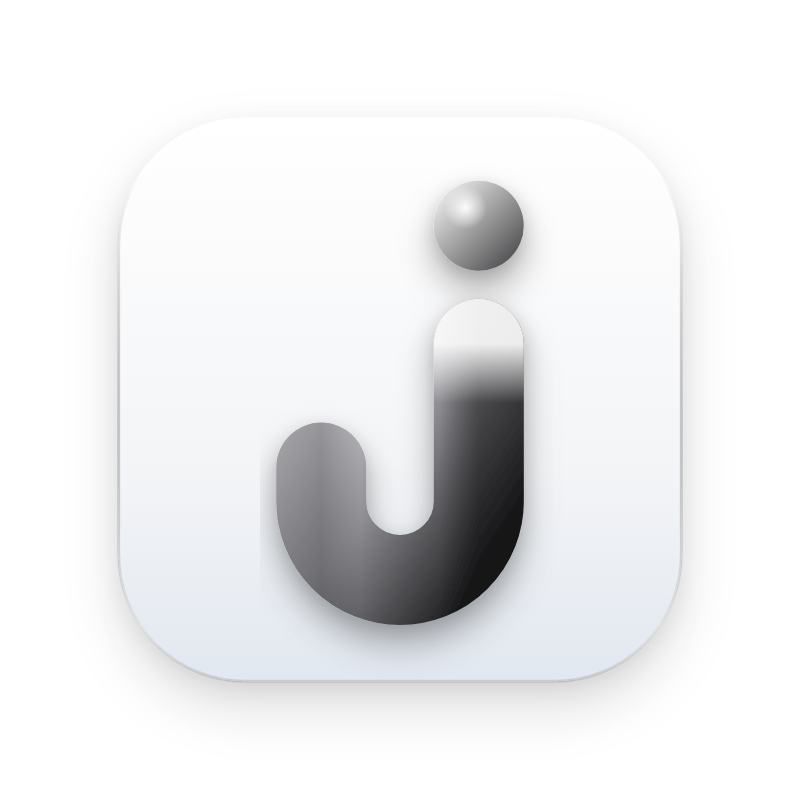
</p>

<h1 align="center">JoeBro</h1>

<p align="center">The Mac workspace for your agents, with a companion iPhone app.</p>

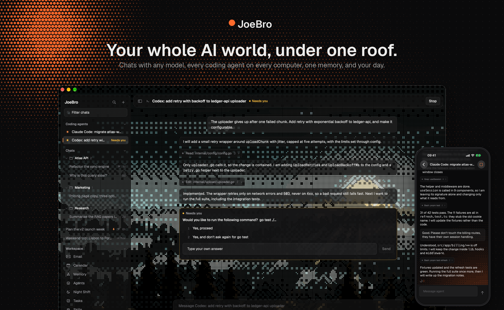

JoeBro is a free, open-source Mac workspace for your AI agents: Claude Code, Codex and OpenCode sessions, your own API keys and local models (Ollama, LM Studio) as agents, your files and editor, one memory they all share, and an iPhone companion. It is for people who already use more than one AI tool: a chat with one model, Claude Code on one machine, Codex on another, a local model on a third. JoeBro brings them into one app, with a memory they share and one place to check on them. It is free, and there is no JoeBro server: your data stays on your own devices.

**Website:** [joebro.pages.dev](https://joebro.pages.dev/) · **iPhone app:** [JoeBro Mobile](https://github.com/joexk1/JoeBro-Mobile) · **Plugins:** [joebro-plugins](https://github.com/joexk1/joebro-plugins)

### Install everything with one command

```bash
curl -fsSL https://joebro.pages.dev/install.sh | bash
```

This is the all-in-one install from [joebro.pages.dev](https://joebro.pages.dev/). It downloads the signed Mac app and checks it, plugs JoeBro into Claude Code, Codex and OpenCode (hooks and the MCP server), links them up, and then offers to set up the iPhone app. You can [read the script](https://joebro.pages.dev/install.sh) first. It needs macOS 26 or later.

---

## What's in it

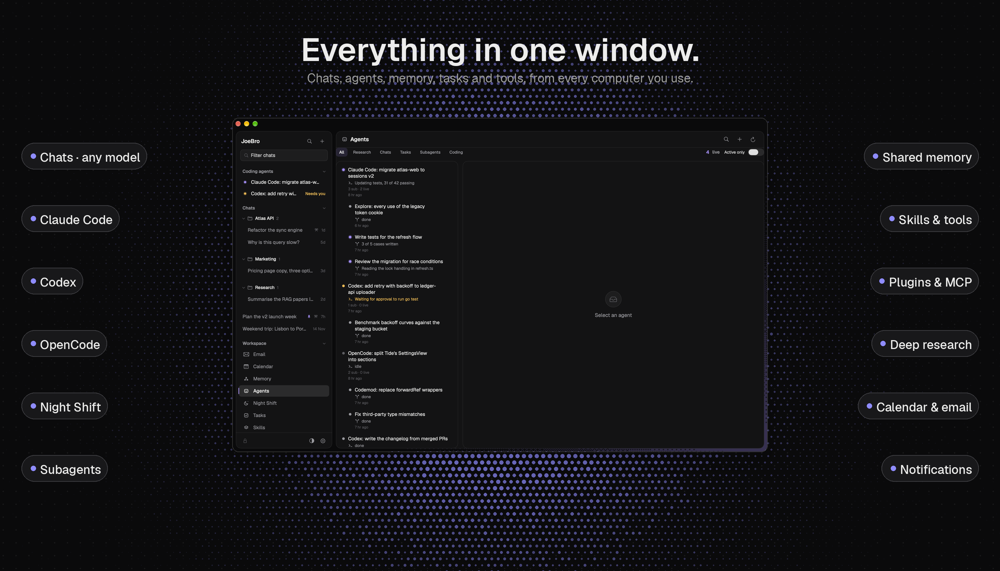

| Feature | What it does |
| --- | --- |
| Chats | Any local model or API key, with a model picker grouped by provider |
| Coding agents | Claude Code, Codex and OpenCode on any of your computers, shown as live chats in the sidebar |
| Night Shift | Coding tasks that run overnight on your machines, with diffs to review in the morning |
| Memory | One memory shared across every agent and device |
| Skills, tools, plugins, MCP servers | One pool that every chat can use |
| Deep research | Many sources in, a cited report out |
| Calendar, email, tasks, notes | Your day, next to your chats |
| Notifications | Approvals, finished work and notes from your agents, in one list |
| Workspace editor | Markdown with a live outline, beside the conversation |
| iPhone | The same chats and coding agents, a personal agent, and approvals on the lock screen |

---

## Coding agents

Claude Code, Codex and OpenCode appear in the sidebar as live chats, whichever of your computers they are running on. Send a message and it lands in the agent's terminal, even mid-turn. When an agent asks you something (a question, a permission prompt, a choice between options), the options appear right in the chat: click one, or type your own answer. Queue messages for when the agent is ready, and watch subagents appear nested under their parent. You can start a session in any folder, or resume an earlier one.

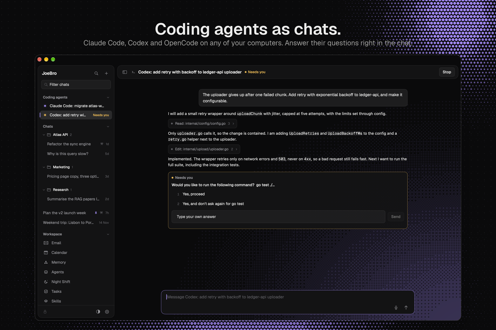

## Chats and models

Chat with any model from any provider, and switch model mid-conversation without losing the thread. The picker is grouped by provider, so a long list of models stays easy to scan. Chats stream live, support extended thinking and have an agent mode that can use your tools. Type `/` for slash commands and skills, or press ⌘K for the command palette to jump to any panel, chat, document or action.

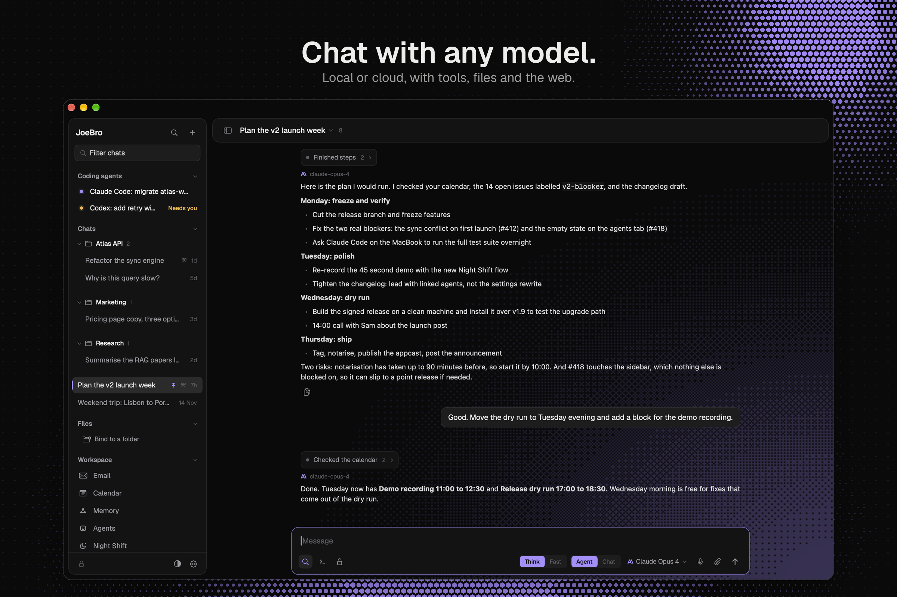

## Night Shift

Queue coding tasks from your Mac or your iPhone: a repo, a prompt and, optionally, a test command. When the night window opens, JoeBro runs each task in its own git branch and worktree, on whichever of your machines has the repo. In the morning every task is a review card with the diff, the test result and a summary. Approve or reject it, or ask for a follow-up. Night Shift never pushes to a remote.

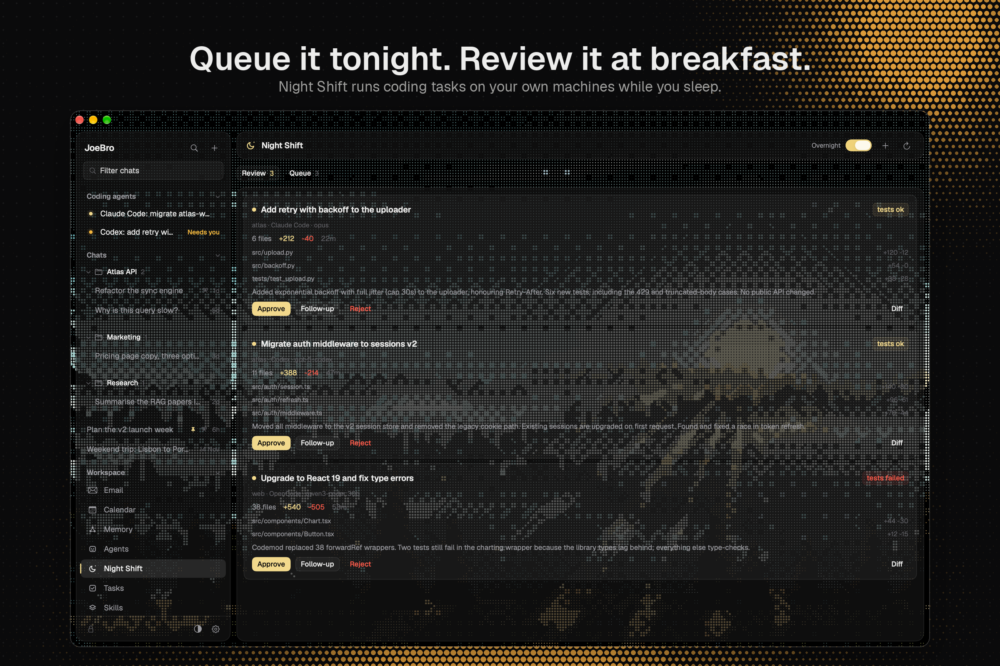

## Memory

Agents learn things as they work: decisions, gotchas, what was tried. Shared memory keeps one store per project that Claude Code, Codex and OpenCode all read and write over MCP, so what one learns the others know. Every fact shows which agent wrote it, with which model, on which machine. Facts that get used grow stronger, those that don't fade, and nothing is deleted. Your personal facts never reach a repo or a coding agent.

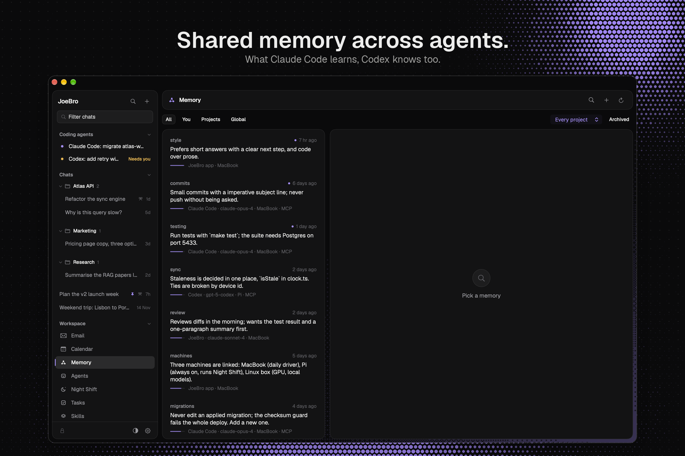

## Skills, tools and plugins

Skills, API tools, MCP servers and plugins live in one pool, and the model can call any of them in the same conversation. JoeBro learns skills from the things you do often, and you can review, edit or remove them by hand. MCP servers run over stdio with a hard timeout on every call, so a broken server never hangs a turn. Plugins are folders on disk that add their own tools and logic.

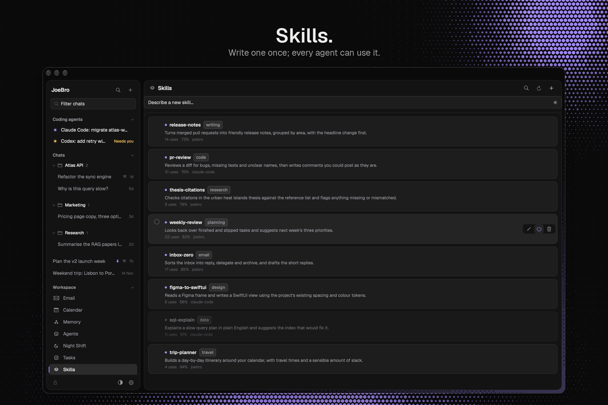

## Workspace editor

Documents open beside the conversation, so you and the model can work on the same text. The editor handles Markdown with a live outline for jumping around long documents, and also opens Word `.doc` and `.docx` files and spreadsheets.

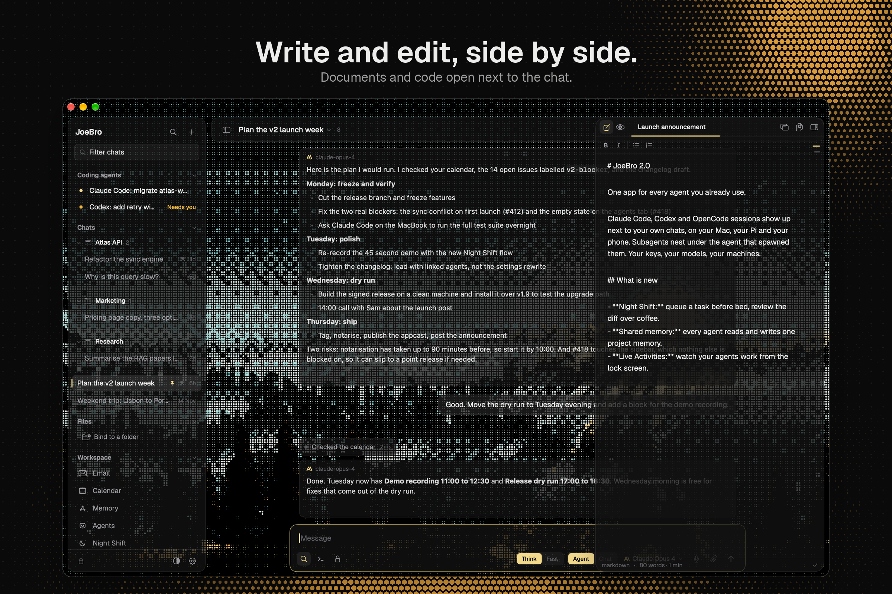

## Agents overview

The Agents panel lists what is running across your machines, what is waiting on you and what has finished, with subagents nested under the agent that started them.

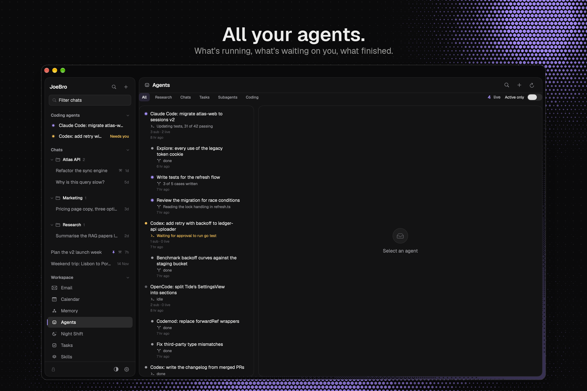

## Themes and backgrounds

JoeBro uses Geist for type and has nine accent palettes, one of which takes its colour from your wallpaper. Behind the interface you can have one of 34 animated ASCII-art scenes, your own photo, or a video loop. An opacity slider controls how solid the panels are, and light or dark follows your system.

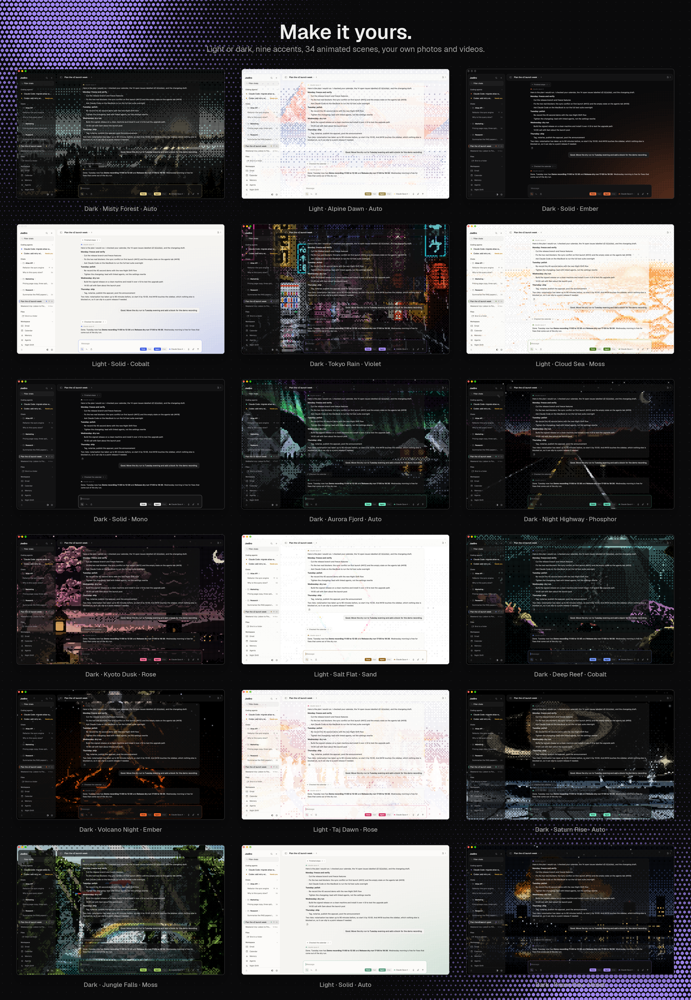

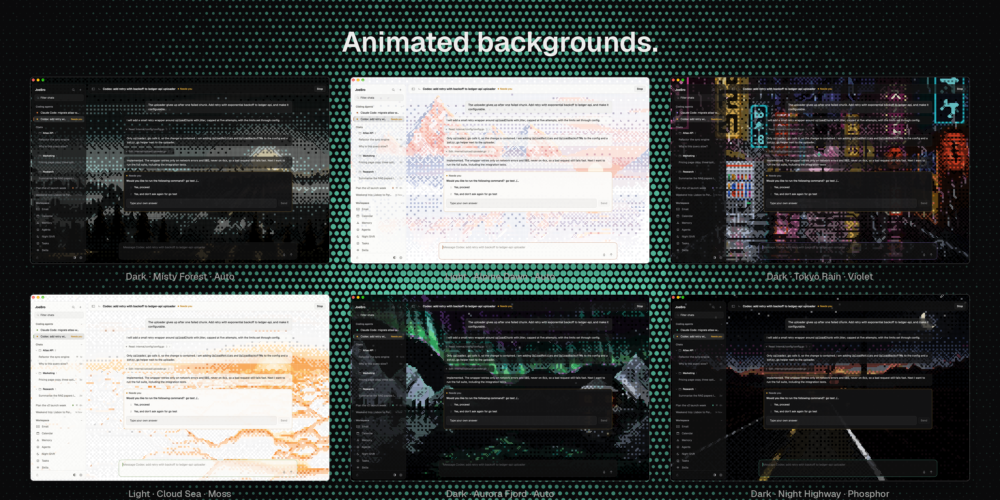

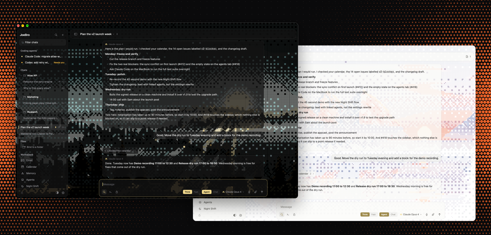

## More of the Mac app

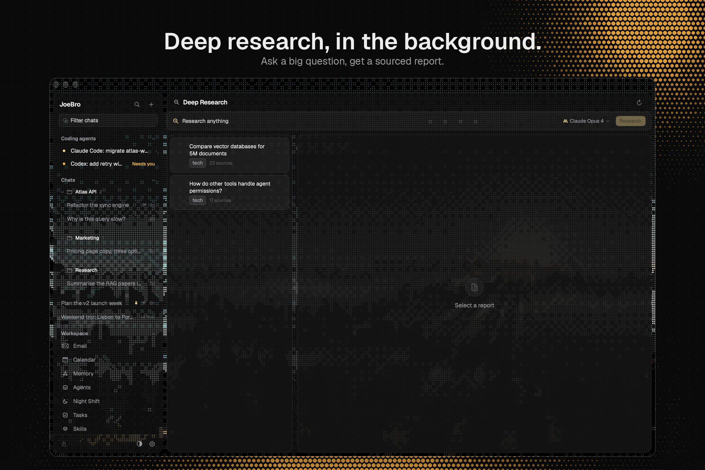

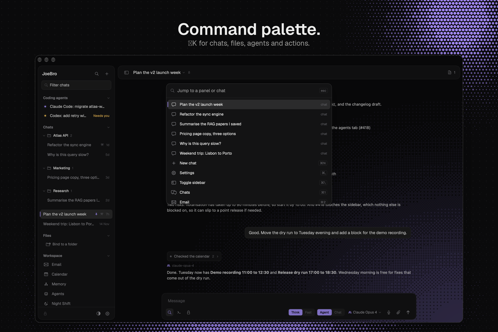

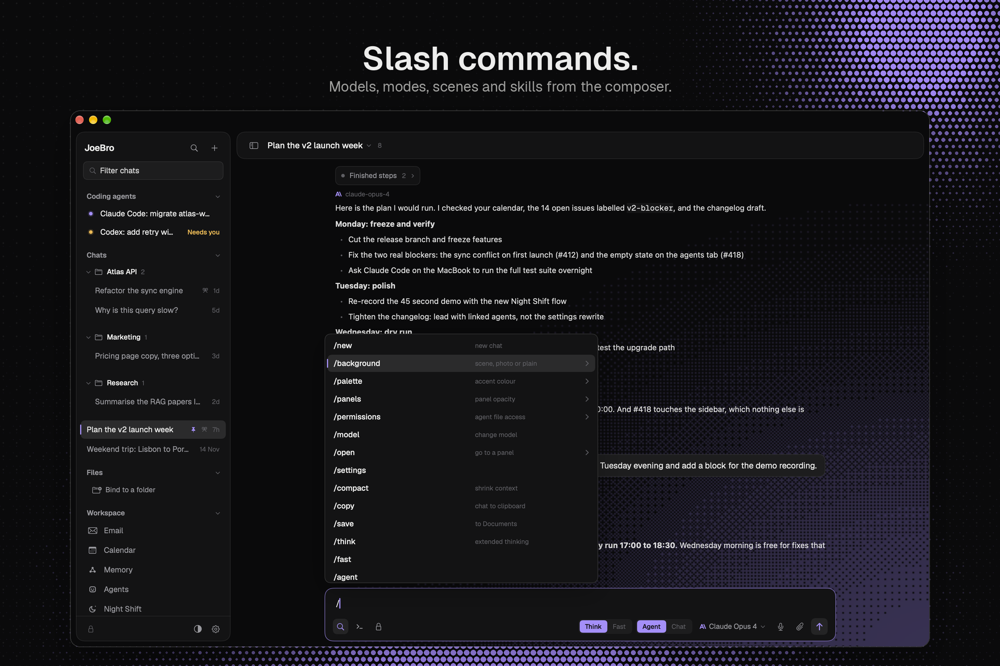

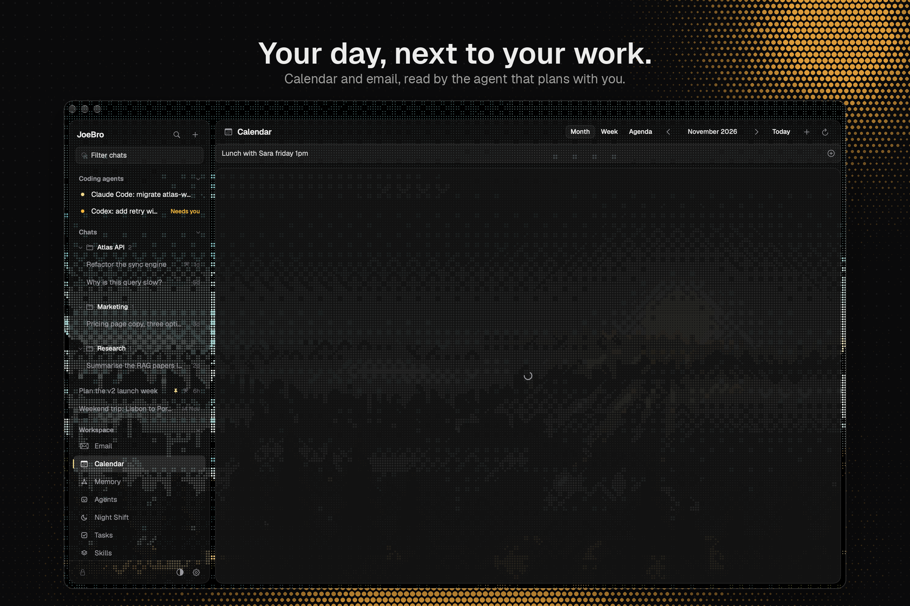

## iPhone

The iPhone app has the same look and the same pool of chats, with your coding agents as chats too. Running agents appear in a Live Activity and the Dynamic Island, and a personal agent on your phone handles background work and pings you when something needs you. It pairs with the Mac app by QR code, with no cloud in between. Details are in the [JoeBro Mobile](https://github.com/joexk1/JoeBro-Mobile) repo.

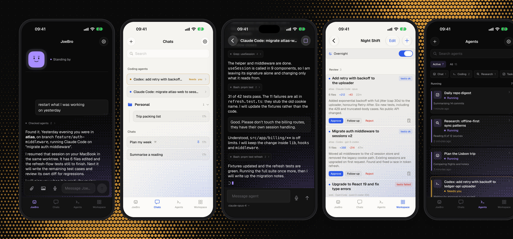

---

## Get started

### Mac

Requirements: **macOS 26 (Tahoe)** or later on Apple Silicon. Python 3 is used by the bundled backend. The system `python3` is fine, and there is nothing to `pip install`.

The quickest way is the one-command install from [joebro.pages.dev](https://joebro.pages.dev/), which sets up the app, your coding agents and, if you want it, the iPhone app:

```bash
curl -fsSL https://joebro.pages.dev/install.sh | bash
```

Or install by hand:

1. Download the latest **JoeBro.dmg** from the [Releases page](https://github.com/joexk1/joebro/releases) and drag **JoeBro** into Applications.
2. Open it. JoeBro is signed with an Apple Developer ID and notarised, so it opens with a plain double-click.
3. Open **Settings** (the gear in the sidebar footer) and add a model endpoint, a local model or an API key.

From then on JoeBro updates itself with Sparkle (**Settings → General → Check for Updates**, or automatically).

### iPhone

The iPhone app is a source release, with no App Store build, so your bundle ID and keys stay yours. You need iOS 17 or later, Xcode, and an Apple ID (a free one is enough for your own phone). See [JoeBro Mobile](https://github.com/joexk1/JoeBro-Mobile) for setup. Then on the Mac open **Settings → Mobile**, turn on **Let my phone connect**, and scan the QR code from the phone. Push notifications are optional and need your own Apple push key.

### Backend

There is nothing to set up. The backend is plain Python standard library, bundled in the app and started when JoeBro launches. It listens locally on `http://127.0.0.1:8765`. To link Claude Code, Codex and OpenCode so they appear in JoeBro, install [joebro-plugins](https://github.com/joexk1/joebro-plugins). For a walkthrough, see [Getting Started](GETTING_STARTED.md) and the [User Guide](USER_GUIDE.md).

---

## Privacy and how it works

- **Local first.** Chats, memory, notes, tasks and documents live in a local SQLite store in `~/Library/Application Support/JoeBro/`.
- **Bring your own models.** Run local models with Ollama or anything OpenAI-compatible, or use an API key for DeepSeek, OpenAI, Anthropic, Groq, Gemini, OpenRouter and others.
- **No telemetry, no middleman.** The app talks to its local backend and to the model endpoints you set up.
- **Cloak Mode.** On by default: API keys, passwords, emails and card, passport and account numbers are swapped for placeholders before any request leaves the backend, local endpoints included.
- **Phone access is off until you turn it on.** It uses a separate listener that needs a token on every request, and it cannot add MCP servers or plugins.

## Build from source

Requires **Xcode 26** or later.

1. Open `JoeBro.xcodeproj` in Xcode.
2. Select the **JoeBro** scheme and a **My Mac** destination.
3. Press Run.

The Python backend is bundled and launches with the app.

## Contributing

Issues and pull requests are welcome. See [CONTRIBUTING.md](CONTRIBUTING.md).

## Licence

GPLv3. See [LICENSE](LICENSE).
